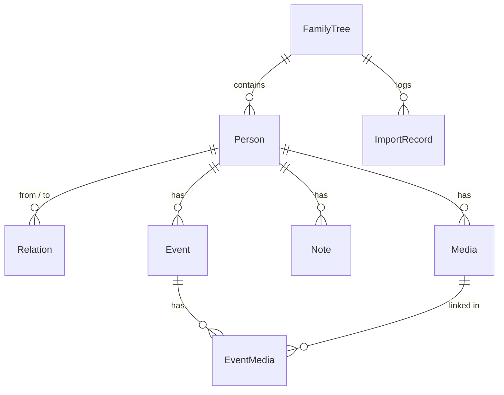

# Architecture

Cognatio is a three-tier web application: a React single-page app, a Node.js API server and a PostgreSQL database. Everything runs locally; there is no external service (the only network access is the desktop app's check for a new version).

The desktop app (Windows, Linux) wraps the same backend in an Electron window and starts the bundled PostgreSQL itself (see the components below).

## Stack

| Layer       | Technology                                                                                                                                                                                                                                                                                                                                               |
| ----------- | -------------------------------------------------------------------------------------------------------------------------------------------------------------------------------------------------------------------------------------------------------------------------------------------------------------------------------------------------------- |
| Frontend    | React 18, TypeScript, Vite, React Router, Apollo Client, zustand (device settings), react-i18next, Tailwind CSS with shadcn/ui-style components, React Flow + dagre (tree graph)                                                                                                                                                                         |
| Backend     | Node.js 22, Express, Apollo Server 5 (GraphQL), Prisma 7 (PrismaPg), zod, multer (uploads), helmet                                                                                                                                                                                                                                                       |
| Database    | PostgreSQL 16 (development: `npm run db:start`; desktop app: bundled)                                                                                                                                                                                                                                                                                    |
| Backup      | Settings → Backup (one ZIP with everything); `pg_dump` safety backups of the bundled database in the desktop app; `npm run db:backup` in development                                                                                                                                                                                                     |
| Desktop app | Electron shell (`desktop/`) around the backend with bundled PostgreSQL (`backend/src/lib/postgres/`); NSIS installer and portable ZIP (Windows), AppImage and `.deb` (Linux) via electron-builder; updates with electron-updater                                                                                                                         |
| Tests       | Jest (backend), Vitest + Testing Library (frontend), Playwright incl. axe accessibility checks (`e2e/`)                                                                                                                                                                                                                                                  |
| CI          | GitLab CI (private development repository) and GitHub Actions (public repository, `.github/workflows`) with the same checks: lint, test (with coverage thresholds, upgrade matrix), build, SAST (CodeQL on GitHub) and secret detection; on a tag the Windows and Linux apps are built and published as a release (GitHub: the one the apps update from) |

In development Vite serves the frontend on port 3000 and proxies `/graphql`, `/api` and `/uploads` to the backend on port 4000, so the browser only talks to one origin (no CORS needed).

## Components

**Backend** (`backend/src/`)

| Folder               | Responsibility                                                                                                                                                    |
| -------------------- | ----------------------------------------------------------------------------------------------------------------------------------------------------------------- |
| `app.ts`, `index.ts` | Express app (middleware, routes) and server start                                                                                                                 |
| `schema/typeDefs.ts` | GraphQL schema                                                                                                                                                    |
| `resolvers/`         | GraphQL resolvers per domain (family trees, persons, relations, events, notes, media, import history, system)                                                     |
| `routes/`            | REST routes for binary data: media upload, export/import, backup/restore, server log (view, export, clear)                                                        |
| `lib/transfer/`      | Export/import: own ZIP format and GEDCOM 5.5.1/7.0, import plan with preview and merge strategies                                                                 |
| `lib/backup/`        | Full backup and restore of all family trees (`cognatio-backup` format)                                                                                            |
| `lib/search/`        | Similarity search and Cologne phonetics                                                                                                                           |
| `lib/files/`         | Storage of uploaded files, profile pictures, data folder of an installation (`COGNATIO_DATA_DIR`)                                                                 |
| `lib/demo/`          | Desktop app, first start: creates the example family tree from `demo/Cognatio-Demo-Familie-Kraft.zip` (`COGNATIO_DEMO_FILE`) once per installation                |
| `lib/postgres/`      | The bundled PostgreSQL of the desktop app: first start (`initdb`), start/stop on a free port, crash recovery, safety backups, migrating with rollback             |
| `lib/` (others)      | Family tree scoping, logging, system information, access token for a local backend, serving the built frontend (`FRONTEND_DIR`), database migrations (own runner) |
| `scripts/`           | Command line tools (`migrate.ts` for `npm run db:migrate`)                                                                                                        |
| `test/`              | Test helpers (Prisma mock, fixtures)                                                                                                                              |
| `../prisma/`         | Schema and migrations (single init migration)                                                                                                                     |

**Frontend** (`frontend/src/`)

Organised by feature; a feature folder holds `components/`, `pages/`, `lib/` (pure logic and hooks), `graphql/` (query documents) and `types/` as needed, with the tests in `__tests__/` next to the code.

| Folder                                                                             | Responsibility                                                                                                                                                                                                |
| ---------------------------------------------------------------------------------- | ------------------------------------------------------------------------------------------------------------------------------------------------------------------------------------------------------------- |
| `features/persons/`                                                                | Person list and detail page, forms (person, relation, event), timeline, notes, files, relation logic, date and name validation                                                                                |
| `features/tree/`                                                                   | Tree page, views (family tree, ancestors, descendants, network), layout and export (PNG, SVG, print)                                                                                                          |
| `features/family-trees/`                                                           | Managing several family trees, active tree                                                                                                                                                                    |
| `features/transfer/`                                                               | Import and export (ZIP, GEDCOM), import history                                                                                                                                                               |
| `features/settings/`                                                               | Settings page (collapsible blocks, search), appearance, backup and restore, system status, log viewer and export                                                                                              |
| `features/statistics/`, `features/dashboard/`, `features/trash/`, `features/help/` | Statistics, dashboard, recycle bin, help page and help texts (`content/<language>.ts`)                                                                                                                        |
| `components/`                                                                      | Shared: `layout` (shell, sidebar, header) and `ui` primitives                                                                                                                                                 |
| `lib/`                                                                             | Shared logic: date parsing, date formatting, error messages, lazy pages, class names; `platform.ts` (backend address, saving files – the desktop app and later a mobile app plug in their own implementation) |
| `stores/`                                                                          | Device settings persisted in the browser (`cognatio-settings`, theme, active tree)                                                                                                                            |
| `i18n/`                                                                            | Translations; languages are discovered from files                                                                                                                                                             |

**Desktop app** (`desktop/`)

| Folder                                      | Responsibility                                                                                                                                                                                          |
| ------------------------------------------- | ------------------------------------------------------------------------------------------------------------------------------------------------------------------------------------------------------- |
| `src/main.ts`                               | Electron main process: single instance, data folder (`%APPDATA%\Cognatio`, `~/.config/Cognatio`), starts the backend with token and kept port, window, error dialog, menu entry of the AppImage         |
| `src/backend.ts`, `utilityBackend.ts`       | Starting and stopping the backend process (an Electron utility process in the app, a Node child process in the tests)                                                                                   |
| `src/origin.ts`, `paths.ts`, `logs.ts`      | Origin check of pages and IPC calls, locations of backend, frontend and PostgreSQL in the installation, last log error for the error dialog                                                             |
| `src/preload.ts`, `settings.ts`, `texts.ts` | Platform layer for the web page (save dialog, quit, updates), shell settings (`desktop.json`: update switch, channel, port of the backend), the few texts of the shell                                  |
| `src/updater.ts`, `feeds.ts`                | Update check and download (newest GitHub or GitLab release, or channel feed), switch and beta channel                                                                                                   |
| `src/desktopEntry.ts`                       | Linux AppImage: writes the application menu entry and icon                                                                                                                                              |
| `scripts/`                                  | `stage.mjs` and `bundle.mjs` (staging and bundling), `prune-postgres.mjs` (slims the PostgreSQL), `smoke.mjs` (test with the real app), `portable.mjs`, `update-test.mjs` (Windows), `channel-feed.mjs` |
| `electron-builder.yml`                      | Installer and package configuration (NSIS, AppImage, deb) and the Electron fuses of the program file                                                                                                    |

PostgreSQL comes from `scripts/fetch-postgres.mjs`: the official binary ZIP on Windows, built from the official source archive on Linux (no relocatable binaries exist). Details and decisions: [distribution concept](distribution-concept.md).

Features may import from other features (`@/features/<name>/...`) only in the directions and for the files that ESLint allows (see [code guidelines](code-guidelines.md#frontend-features)); everything shared by all features stays in `components/`, `lib/` and `stores/`.

## Data model

Persons and family trees are soft-deleted (`isDeleted`, recycle bin), relations are deactivated (`active`). Every person belongs to exactly one family tree; relations, events and notes are reached through their person, media and import records carry the family tree themselves (a medium can also be without a person).

## Family tree scoping

Every API request works in exactly one family tree. The frontend sends its id in the header `X-Family-Tree-Id` (downloads may use `?familyTree=`). The backend resolves it lazily on first access: an unknown or deleted tree gives `TREE_NOT_FOUND`; without a header the oldest tree is used. The backend never creates a tree by itself: with none at all (empty database, all in the recycle bin) such requests also give `TREE_NOT_FOUND`, and the frontend shows only the pages that need no tree (family trees, import/export, recycle bin, settings, help) and otherwise offers to create, import or restore one.

## Interfaces

### GraphQL – `POST /graphql`

Used for all structured data. Operations, grouped by domain:

| Domain           | Queries                                                                    | Mutations                                                                                                |
| ---------------- | -------------------------------------------------------------------------- | -------------------------------------------------------------------------------------------------------- |
| Family trees     | `familyTrees`, `deletedFamilyTrees`, `activeFamilyTree`, `locatePerson`    | `createFamilyTree`, `updateFamilyTree`, `deleteFamilyTree`, `restoreFamilyTree`, `hardDeleteFamilyTree`  |
| Persons          | `getPersons`, `getDeletedPersons`, `getPerson`, `search`, `similarPersons` | `createPerson`, `updatePerson`, `deletePerson`, `restorePerson`, `hardDeletePerson`, `setProfilePicture` |
| Relations        | `getRelations`, `getPersonRelations`                                       | `createRelation`, `updateRelation`, `deleteRelation`, `restoreRelation`, `hardDeleteRelation`            |
| Events and notes | `getEvents`, `getNotes`                                                    | `createEvent`, `updateEvent`, `deleteEvent`, `createNote`, `updateNote`, `deleteNote`                    |
| Media            | `getPersonMedia`, `getLinkedMedia`                                         | `deleteMedia`                                                                                            |
| System           | `healthCheck`, `systemInfo`, `importHistory`, `sizeLimits`                 | `setLogLevel`, `setSizeLimits`                                                                           |

`search` matches across all fields including events and notes, with phonetic matching, and reports where each person was found. Times are ISO 8601 timestamps; a note has at most 10,000 characters.

### REST – `/api/v1`

Used for binary data and long-running transfers (multipart uploads, file downloads).

| Method and path                                 | Purpose                                                                                                      |
| ----------------------------------------------- | ------------------------------------------------------------------------------------------------------------ |
| `GET /health`                                   | Application and database status (200 or 503); for CI and monitoring                                          |
| `POST /media/upload`                            | Upload a file (multipart `file`, plus `personId` or `eventId`, and `type`); max. 50 MB (413 above)           |
| `GET /media/:id/download`                       | Save a medium under its original file name (the family tree as `?familyTree=`, since a link sends no header) |
| `GET /export/zip`                               | Export the active tree as ZIP (`?media=0` leaves media out)                                                  |
| `GET /export/gedcom`                            | GEDCOM export (`?version=5.5.1\|7.0`, `?media=1` for GEDZIP)                                                 |
| `POST /import/preview`                          | Analyse an import file (ZIP or GEDCOM) and return the plan without changing data                             |
| `POST /import/execute`                          | Run the import (`strategy`, `decisions`, `target` = active or `NEW`, `treeName`); max. 2 GB by default       |
| `GET /backup`                                   | Backup file of all family trees (ZIP: `manifest.json`, `data.json`, `files/`)                                |
| `POST /backup/preview`                          | Check a backup file and describe its content                                                                 |
| `POST /backup/restore`                          | Restore; requires `confirm=DELETE_ALL`, writes a safety backup first, all-or-nothing                         |
| `GET /logs`, `GET /logs/export`, `DELETE /logs` | View the server log (level filter), export it as ZIP for the error analysis, clear it                        |

Errors are JSON `{ error, reason }` with a stable `reason` code that the frontend translates. Every request must name the backend under its own address in the Host header (IP address, `localhost`, `ALLOWED_HOSTS`, otherwise `403 HOST_NOT_ALLOWED`), and changes from another website are refused (`403 CROSS_SITE_REQUEST`), see `backend/src/lib/requestGuard.ts`.

Export, import (preview and run), backup and restore hold whole files in memory and read or replace much of the data, so only one of them runs at a time: another one is answered with `409 OPERATION_IN_PROGRESS` (`backend/src/lib/transfer/oneAtATime.ts`). The guard is taken before the upload, so a refused file is read and dropped instead of being kept in memory, and it is released only when the work has finished and the response is closed – a client that cancels does not stop an import that is still writing. A media upload and the permanent deletion of a person or family tree lock the family tree in their transaction, so they run one after the other.

### Static files – `GET /uploads/<file>`

Any file type can be uploaded. Uploaded media are served with a strict Content-Security-Policy so scripts in uploaded HTML or SVG files do not run, and only images, PDF, video and audio are shown by the browser – everything else (HTML, SVG, ZIP, GPX, ...) is sent as a download (`downloadUnlessSafe` in `backend/src/app.ts`).

### Files and formats

| Interface     | Format                                                                                                                                              |
| ------------- | --------------------------------------------------------------------------------------------------------------------------------------------------- |
| Export/import | Cognatio ZIP (`persons.json` + `media/`) and GEDCOM 5.5.1 / 7.0 (GEDZIP with media), with Cognatio-specific extension tags `_TYPE`, `_LANGUAGE`     |
| Backup        | ZIP `cognatio-backup` v1 with SHA-256 checksum of `data.json`                                                                                       |
| Safety backup | `pg_dump` file in `backups/` (development: `npm run db:backup`; desktop app: before every migration and daily in `backups/db`, the last 5 are kept) |

## Configuration

| Variable                                           | Default                                                                           | Meaning                                                                                                                                                                                                                                                                                                                         |
| -------------------------------------------------- | --------------------------------------------------------------------------------- | ------------------------------------------------------------------------------------------------------------------------------------------------------------------------------------------------------------------------------------------------------------------------------------------------------------------------------- |
| `DATABASE_URL`                                     | –                                                                                 | PostgreSQL connection (`backend/.env`)                                                                                                                                                                                                                                                                                          |
| `PORT`                                             | 4000                                                                              | Backend port                                                                                                                                                                                                                                                                                                                    |
| `HOST`, `ALLOWED_HOSTS`                            | `127.0.0.1`, none                                                                 | Address the backend listens on; further host names it answers to (e.g. a reverse proxy)                                                                                                                                                                                                                                         |
| `CORS_ORIGINS`                                     | none                                                                              | Comma-separated extra allowed origins                                                                                                                                                                                                                                                                                           |
| `BACKUP_DIR`                                       | `backups/` in the project folder (`COGNATIO_DATA_DIR/backups` with a data folder) | Where backups are written                                                                                                                                                                                                                                                                                                       |
| `IMPORT_MAX_MB`, `BACKUP_MAX_MB`                   | 2048, 2048                                                                        | Size limits (MB) of an import/export file and of a backup file (the user can change them in the settings; they are kept in `settings.json`, `lib/files/appSettings.ts`, and win over the variables); the media of a larger export are refused with a message, a larger backup is created with a warning (it cannot be restored) |
| `IMPORT_MAX_UNPACKED_MB`, `BACKUP_MAX_UNPACKED_MB` | 4096, 4096                                                                        | Limit of the unpacked content (protection against "zip bombs")                                                                                                                                                                                                                                                                  |
| `LOG_LEVEL`                                        | info                                                                              | `debug`, `info`, `warn`, `error` or `silent`                                                                                                                                                                                                                                                                                    |

The complete list (data folder, access token, bundled PostgreSQL, update feeds, logging) is in the [README](../README.md#configuration).

See also: [README](../README.md), [adding a language](adding-a-language.md), [code guidelines](code-guidelines.md).
