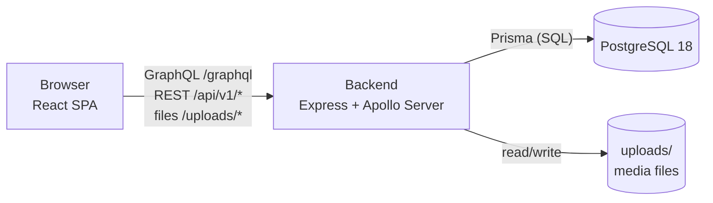
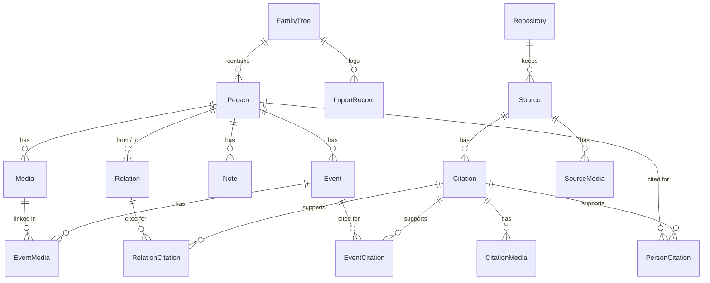

# Architecture

Cognatio is a three-tier web application: a React single-page app, a Node.js API server and a PostgreSQL database. Everything runs locally; there is no external service (the only network access is the desktop app's check for a new version).

The desktop app (Windows, Linux) wraps the same backend in an Electron window and starts the bundled PostgreSQL itself (see the components below).

## Stack

| Layer       | Technology                                                                                                                                                                                                                                                                                                                                               |
| ----------- | -------------------------------------------------------------------------------------------------------------------------------------------------------------------------------------------------------------------------------------------------------------------------------------------------------------------------------------------------------- |
| Frontend    | React 18, TypeScript, Vite, React Router, Apollo Client, zustand (device settings), react-i18next, Tailwind CSS with shadcn/ui-style components, React Flow + dagre (tree graph)                                                                                                                                                                         |
| Backend     | Node.js 22, Express, Apollo Server 5 (GraphQL), Prisma 7 (PrismaPg), zod, multer (uploads), helmet                                                                                                                                                                                                                                                       |
| Database    | PostgreSQL 18 (development: `npm run db:start`; desktop app: bundled)                                                                                                                                                                                                                                                                                    |
| Backup      | Settings → Backup (one ZIP with everything); `pg_dump` safety backups of the bundled database in the desktop app; `npm run db:backup` in development                                                                                                                                                                                                     |
| Desktop app | Electron shell (`desktop/`) around the backend with bundled PostgreSQL (`backend/src/lib/postgres/`); NSIS installer and portable ZIP (Windows), AppImage and `.deb` (Linux) via electron-builder; updates with electron-updater                                                                                                                         |
| Tests       | Jest (backend), Vitest + Testing Library (frontend), Playwright incl. axe accessibility checks (`e2e/`)                                                                                                                                                                                                                                                  |
| CI          | GitLab CI (private development repository) and GitHub Actions (public repository, `.github/workflows`) with the same checks: lint, test (with coverage thresholds, upgrade matrix), build, SAST (CodeQL on GitHub) and secret detection; on a tag the Windows and Linux apps are built and published as a release (GitHub: the one the apps update from) |

In development Vite serves the frontend on port 3000 and proxies `/graphql`, `/api` and `/uploads` to the backend on port 4000, so the browser only talks to one origin (no CORS needed).

## Components

**Backend** (`backend/src/`)

| Folder               | Responsibility                                                                                                                                                    |
| -------------------- | ----------------------------------------------------------------------------------------------------------------------------------------------------------------- |
| `app.ts`, `index.ts` | Express app (middleware, routes) and server start                                                                                                                 |
| `schema/typeDefs.ts` | GraphQL schema                                                                                                                                                    |
| `resolvers/`         | GraphQL resolvers per domain (family trees, persons, relations, events, notes, media, import history, system)                                                     |
| `routes/`            | REST routes for binary data: media upload, export/import, backup/restore, server log (view, export, clear)                                                        |
| `lib/transfer/`      | Export/import: own ZIP format and GEDCOM 5.5.1/7.0, import plan with preview and merge strategies                                                                 |
| `lib/backup/`        | Full backup and restore of all family trees (`cognatio-backup` format)                                                                                            |
| `lib/mcp/`           | AI assistants: the endpoint `/mcp` (Model Context Protocol), its token and permissions (`settings.json`) and the tools, which run GraphQL operations of the app   |
| `lib/search/`        | Similarity search and Cologne phonetics                                                                                                                           |
| `lib/statistics/`    | Figures of the page "Statistics" for a scope, with the persons behind each figure                                                                                 |
| `lib/files/`         | Storage of uploaded files, profile pictures, data folder of an installation (`COGNATIO_DATA_DIR`)                                                                 |
| `lib/demo/`          | Desktop app, first start: creates the example family tree from `demo/Cognatio-Demo-Familie-Kraft.zip` (`COGNATIO_DEMO_FILE`) once per installation                |
| `lib/postgres/`      | The bundled PostgreSQL of the desktop app: first start (`initdb`), start/stop on a free port, crash recovery, safety backups, migrating with rollback             |
| `lib/` (others)      | Family tree scoping, logging, system information, access token for a local backend, serving the built frontend (`FRONTEND_DIR`), database migrations (own runner) |
| `scripts/`           | Command line tools (`migrate.ts` for `npm run db:migrate`)                                                                                                        |
| `test/`              | Test helpers (Prisma mock, fixtures)                                                                                                                              |
| `../prisma/`         | Schema and migrations (single init migration)                                                                                                                     |

**Frontend** (`frontend/src/`)

Organised by feature; a feature folder holds `components/`, `pages/`, `lib/` (pure logic and hooks), `graphql/` (query documents) and `types/` as needed, with the tests in `__tests__/` next to the code.

| Folder                                                                             | Responsibility                                                                                                                                                                                                |
| ---------------------------------------------------------------------------------- | ------------------------------------------------------------------------------------------------------------------------------------------------------------------------------------------------------------- |
| `features/persons/`                                                                | Person list and detail page, forms (person, relation, event), timeline, notes, files, relation logic, date and name validation                                                                                |
| `features/tree/`                                                                   | Tree page, views (family tree, ancestors, descendants, network), layout and export (PNG, SVG, print)                                                                                                          |
| `features/family-trees/`                                                           | Managing several family trees, active tree                                                                                                                                                                    |
| `features/transfer/`                                                               | Import and export (ZIP, GEDCOM), import history                                                                                                                                                               |
| `features/settings/`                                                               | Settings page (collapsible blocks, search), appearance, backup and restore, system status, log viewer and export                                                                                              |
| `features/statistics/`, `features/dashboard/`, `features/trash/`, `features/help/` | Statistics, dashboard, recycle bin, help page and help texts (`content/<language>.ts`)                                                                                                                        |
| `components/`                                                                      | Shared: `layout` (shell, sidebar, header) and `ui` primitives                                                                                                                                                 |
| `lib/`                                                                             | Shared logic: date parsing, date formatting, error messages, lazy pages, class names; `platform.ts` (backend address, saving files – the desktop app and later a mobile app plug in their own implementation) |
| `stores/`                                                                          | Device settings persisted in the browser (`cognatio-settings`, theme, active tree)                                                                                                                            |
| `i18n/`                                                                            | Translations; languages are discovered from files                                                                                                                                                             |

**Desktop app** (`desktop/`)

| Folder                                      | Responsibility                                                                                                                                                                                          |
| ------------------------------------------- | ------------------------------------------------------------------------------------------------------------------------------------------------------------------------------------------------------- |
| `src/main.ts`                               | Electron main process: single instance, data folder (`%APPDATA%\Cognatio`, `~/.config/Cognatio`), starts the backend with token and kept port, window, error dialog, menu entry of the AppImage         |
| `src/backend.ts`, `utilityBackend.ts`       | Starting and stopping the backend process (an Electron utility process in the app, a Node child process in the tests)                                                                                   |
| `src/origin.ts`, `paths.ts`, `logs.ts`      | Origin check of pages and IPC calls, locations of backend, frontend and PostgreSQL in the installation, last log error for the error dialog                                                             |
| `src/preload.ts`, `settings.ts`, `texts.ts` | Platform layer for the web page (save dialog, quit, updates), shell settings (`desktop.json`: update switch, channel, port of the backend), the few texts of the shell                                  |
| `src/updater.ts`, `feeds.ts`                | Update check and download (newest GitHub or GitLab release, or channel feed), switch and beta channel                                                                                                   |
| `src/desktopEntry.ts`                       | Linux AppImage: writes the application menu entry and icon                                                                                                                                              |
| `scripts/`                                  | `stage.mjs` and `bundle.mjs` (staging and bundling), `prune-postgres.mjs` (slims the PostgreSQL), `smoke.mjs` (test with the real app), `portable.mjs`, `update-test.mjs` (Windows), `channel-feed.mjs` |
| `electron-builder.yml`                      | Installer and package configuration (NSIS, AppImage, deb) and the Electron fuses of the program file                                                                                                    |

PostgreSQL comes from `scripts/fetch-postgres.mjs`: the official binary ZIP on Windows, built from the official source archive on Linux (no relocatable binaries exist). A release that changes the PostgreSQL major version also ships the old server in `postgres/upgrade/<major>`; the backend converts an old database folder with it at the start (`backend/src/lib/postgres/majorUpgrade.ts`). Details and decisions: [distribution concept](distribution-concept.md).

Features may import from other features (`@/features/<name>/...`) only in the directions and for the files that ESLint allows (see [code guidelines](code-guidelines.md#frontend-features)); everything shared by all features stays in `components/`, `lib/` and `stores/`.

## Data model

Persons and family trees are soft-deleted (`isDeleted`, recycle bin), relations are deactivated (`active`). Every person belongs to exactly one family tree; relations, events and notes are reached through their person, media and import records carry the family tree themselves (a medium can also be without a person).

Archives (`Repository`), sources and citations form **one library for all family trees** – they carry no family tree.
A citation supports any number of facts through three link tables: a fact of a person (`GENERAL`, `NAME`, `BIRTH`,
`DEATH`), an event or a relation, also in several family trees; a page of a family tree sees a citation through the
links of its own persons. Scans of sources and citations are media without family tree and person; they are removed
with their file once nothing links them any more (`lib/libraryMedia.ts`). Sources and archives go into the recycle bin
(`isDeleted`) – a source together with its citations. Concept: `documentation/sources-concept.md`.

A parent-child relation must not make a person their own ancestor: the relation resolvers refuse it (`CYCLE`). An import file or a backup can still contain such a cycle; the import preview (`cycles` per strategy) and the backup preview (`cycleTrees`) name it, and the data is taken over anyway (`backend/src/lib/transfer/cycles.ts`). The tree and the statistics cope with cycles.

Possible errors – facts that are allowed but rarely true, such as a man as mother, a mother of 60 or an event after the death – are found by `backend/src/lib/plausibility/checks.ts` (pure functions; an approximate date counts five years either way). The page "Possible errors" (`plausibilityIssues`) lists them for the open family tree; an issue marked as right is kept by its key in `FamilyTree.checkedIssues` and so travels with every backup. `createRelation` and `updateRelation` refuse a relation with such an issue (`IMPLAUSIBLE`, the issues in `extensions.issues`) unless `confirmed` is true; the frontend asks first, an AI assistant has to ask as well.

## Family tree scoping

Every API request works in exactly one family tree. The frontend sends its id in the header `X-Family-Tree-Id` (downloads may use `?familyTree=`). The backend resolves it lazily on first access: an unknown or deleted tree gives `TREE_NOT_FOUND`; without a header the oldest tree is used. The backend never creates a tree by itself: with none at all (empty database, all in the recycle bin) such requests also give `TREE_NOT_FOUND`, and the frontend shows only the pages that need no tree (family trees, import/export, recycle bin, settings, help) and otherwise offers to create, import or restore one.

## Interfaces

### GraphQL – `POST /graphql`

Used for all structured data. Operations, grouped by domain:

| Domain           | Queries                                                                                                                                                | Mutations                                                                                                                                                                              |
| ---------------- | ------------------------------------------------------------------------------------------------------------------------------------------------------ | -------------------------------------------------------------------------------------------------------------------------------------------------------------------------------------- |
| Family trees     | `familyTrees`, `deletedFamilyTrees`, `activeFamilyTree`, `locatePerson`                                                                                | `createFamilyTree`, `updateFamilyTree`, `setHomePerson`, `deleteFamilyTree`, `restoreFamilyTree`, `hardDeleteFamilyTree`                                                               |
| Persons          | `getPersons`, `getDeletedPersons`, `getPerson`, `search`, `similarPersons`                                                                             | `createPerson`, `updatePerson`, `deletePerson`, `restorePerson`, `hardDeletePerson`, `setProfilePicture`                                                                               |
| Relations        | `getRelations`, `getPersonRelations`                                                                                                                   | `createRelation`, `updateRelation` (both with `confirmed`), `deleteRelation`, `restoreRelation`, `hardDeleteRelation`                                                                  |
| Possible errors  | `plausibilityIssues`                                                                                                                                   | `checkPlausibilityIssue`                                                                                                                                                               |
| Statistics       | `treeStatistics(scope, language, ancestorsOf)`, `statisticsPersons(filter, scope)`                                                                     | —                                                                                                                                                                                      |
| Events and notes | `getEvents`, `getNotes`                                                                                                                                | `createEvent`, `updateEvent`, `deleteEvent`, `createNote`, `updateNote`, `deleteNote`                                                                                                  |
| Media            | `getPersonMedia`, `getLinkedMedia`                                                                                                                     | `deleteMedia`                                                                                                                                                                          |
| Sources          | `sources(scope: TREE\|ALL)`, `source`, `repositories`, `deletedSources`, `deletedRepositories`, `personCitations`, `searchSources`, `sourceStatistics` | `create`/`update`/`delete`/`restore`/`hardDelete` `Source` and `Repository`, `createCitation` (with `targets`), `updateCitation`, `deleteCitation`, `linkCitation`, `unlinkCitation`   |
| System           | `healthCheck`, `systemInfo`, `importHistory`, `sizeLimits`                                                                                             | `setLogLevel`, `setSizeLimits`                                                                                                                                                         |
| AI assistants    | `mcpSettings`, `mcpActivity(after)`                                                                                                                    | `enableMcp`, `disableMcp`, `renewMcpToken` (each answers the token once), `setMcpPermissions`, `setMcpExcludedTrees` – refused when an assistant calls them (`MCP_SETTINGS_FORBIDDEN`) |

`search` matches across all fields including events and notes, with phonetic matching, and reports where each person was found. Times are ISO 8601 timestamps; a note has at most 10,000 characters.

### REST – `/api/v1`

Used for binary data and long-running transfers (multipart uploads, file downloads).

| Method and path                                  | Purpose                                                                                                                                                                                                                                                                                     |
| ------------------------------------------------ | ------------------------------------------------------------------------------------------------------------------------------------------------------------------------------------------------------------------------------------------------------------------------------------------- |
| `GET /health`                                    | Application and database status (200 or 503); for CI and monitoring                                                                                                                                                                                                                         |
| `POST /media/upload`                             | Upload a file (multipart `file`, plus `personId` or `eventId` – or `sourceId` or `citationId` for a scan of the library –, and `type`); no limit per file, `413 NOT_ENOUGH_SPACE` if the drive is too full; a file named as a picture or PDF that is none gives `400 FILE_CONTENT_MISMATCH` |
| `GET /media/:id/download`                        | Save a medium under its original file name (the family tree as `?familyTree=`, since a link sends no header)                                                                                                                                                                                |
| `GET /export/zip`                                | Export the active tree as ZIP (`?media=0` leaves media out), written while it is sent, with `Content-Length`; `?check=1` answers only `{ filename, size, missingMedia }`; `?activity=<uuid>` names the job that counts the bytes sent (progress and cancelling, also in the browser)        |
| `GET /export/gedcom`                             | GEDCOM export (`?version=5.5.1\|7.0`, `?media=1` for GEDZIP); `?check=1` as above                                                                                                                                                                                                           |
| `POST /import/upload`                            | Receive an import file once (multipart `file`) into `uploads/.staging/`; answers `{ uploadId, size }` (201)                                                                                                                                                                                 |
| `POST /import/preview`                           | Analyse the uploaded file (JSON `uploadId`, `target`) and return the plan without changing data                                                                                                                                                                                             |
| `POST /import/execute`                           | Start the import (JSON `uploadId`, `strategy`, `decisions`, `target` = active or `NEW`, `treeName`); answers `{ jobId }` (202)                                                                                                                                                              |
| `GET /backup`                                    | Backup file of all family trees (ZIP: `manifest.json`, `data.json`, `files/`), streamed; `?check=1` as above (with `overLimit`)                                                                                                                                                             |
| `POST /backup/upload`                            | Receive a backup file once; answers `{ uploadId, size }`                                                                                                                                                                                                                                    |
| `POST /backup/preview`                           | Check the uploaded backup (JSON `uploadId`) and describe its content and the size of the current media                                                                                                                                                                                      |
| `POST /backup/restore`                           | Start the restore (JSON `uploadId`, `confirm=DELETE_ALL`): safety backup first, all-or-nothing; answers `{ jobId }`                                                                                                                                                                         |
| `GET /jobs`, `GET /jobs/:id`, `DELETE /jobs/:id` | The running jobs (after reloading the page); state of an import, restore or download (`operation`, `label`, `state`, `phase`, `done`/`total` bytes, `cancellable`, at the end `status` and `result`); cancel it before the database step (a download is broken off at once)                 |
| `GET /logs`, `GET /logs/export`, `DELETE /logs`  | View the server log (level filter), export it as ZIP for the error analysis, clear it                                                                                                                                                                                                       |

Errors are JSON `{ error, reason }` with a stable `reason` code that the frontend translates. Every request must name the backend under its own address in the Host header (IP address, `localhost`, `ALLOWED_HOSTS`, otherwise `403 HOST_NOT_ALLOWED`), and changes from another website are refused (`403 CROSS_SITE_REQUEST`), see `backend/src/lib/requestGuard.ts`.

Export, import, backup and restore read the files piece by piece (`lib/files/archive.ts` with yauzl, `lib/files/zipWriter.ts` with yazl; ZIP64 only above 4 GB, so small archives stay readable by older versions); only the records are held in memory. They read or replace much of the data, so only one of them runs at a time (`backend/src/lib/transfer/oneAtATime.ts`): a download or check is answered with `409 OPERATION_IN_PROGRESS`, an import or restore runs as a job (`lib/transfer/jobs.ts`) that waits for the guard – e.g. for the download of the current state the page started just before a restore. The guard of a download is released when the response is closed. Uploaded files wait in `uploads/.staging/` (`lib/files/stagedUploads.ts`) for a day at most and are removed at every start; before writing, the free space of the drive is checked (`lib/files/freeSpace.ts`, `413 NOT_ENOUGH_SPACE`). A media upload and the permanent deletion of a person or family tree lock the family tree in their transaction, so they run one after the other.

### MCP – `POST /mcp`

AI assistants (Claude Desktop, Claude Code and other clients of the Model Context Protocol) connect here; it is switched
on and set up in Settings → "AI assistants (MCP)" (concept and decisions: [MCP concept](mcp-concept.md)). Streamable HTTP
without sessions (`@modelcontextprotocol/sdk`, JSON answers; `GET` answers 405). The endpoint has its own token
(`Authorization: Bearer …`; only its SHA-256 hash is kept in `settings.json`) and is mounted before the access token of
the desktop app. It refuses requests with an `Origin` (web pages, 403), without or with a wrong token (401) and everything
while switched off (404), and answers at most 20 requests per second (429).

Every request lists only the tools the permissions of that moment allow (per area: off, read, write, delete), and a call
is checked again. Tools run the GraphQL operations of the app (`lib/mcp/graphql.ts`, context `source: "mcp"`); the long
ones (export, import, backup, restore) start the same jobs as the REST routes. Files are named by their path on this
computer, only in the home, data and backup folders (`lib/files/localFiles.ts`). Each call is logged with the component
`mcp` (tool, family tree, ids – no field values); changes are kept in memory for the page "Activity" (`mcpActivity`).
Answers above 200,000 characters are cut.

### Static files – `GET /uploads/<file>`

Any file type can be uploaded. Uploaded media are served with a strict Content-Security-Policy so scripts in uploaded HTML or SVG files do not run, and only images, PDF, video, audio and text files are shown by the browser – text files (TXT, Markdown, CSV, JSON, XML, GPX, GEDCOM …) as plain text, everything else (HTML, SVG, ZIP, ...) is sent as a download (`backend/src/lib/files/viewable.ts`, `uploadHeaders` in `backend/src/app.ts`). The field `viewable` of `Media` tells the frontend which files open in a viewer and which start a download directly; `?name=` names the file for the viewer and for "Save as".

### Files and formats

| Interface     | Format                                                                                                                                              |
| ------------- | --------------------------------------------------------------------------------------------------------------------------------------------------- |
| Export/import | Cognatio ZIP (`persons.json` + `media/`) and GEDCOM 5.5.1 / 7.0 (GEDZIP with media), with Cognatio-specific extension tags `_TYPE`, `_LANGUAGE`     |
| Backup        | ZIP `cognatio-backup` v1 with SHA-256 checksum of `data.json`                                                                                       |
| Safety backup | `pg_dump` file in `backups/` (development: `npm run db:backup`; desktop app: before every migration and daily in `backups/db`, the last 5 are kept) |

## Configuration

| Variable                                           | Default                                                                           | Meaning                                                                                                                                                                                                                                                                                                                  |
| -------------------------------------------------- | --------------------------------------------------------------------------------- | ------------------------------------------------------------------------------------------------------------------------------------------------------------------------------------------------------------------------------------------------------------------------------------------------------------------------ |
| `DATABASE_URL`                                     | –                                                                                 | PostgreSQL connection (`backend/.env`)                                                                                                                                                                                                                                                                                   |
| `PORT`                                             | 4000                                                                              | Backend port                                                                                                                                                                                                                                                                                                             |
| `HOST`, `ALLOWED_HOSTS`                            | `127.0.0.1`, none                                                                 | Address the backend listens on; further host names it answers to (e.g. a reverse proxy)                                                                                                                                                                                                                                  |
| `CORS_ORIGINS`                                     | none                                                                              | Comma-separated extra allowed origins                                                                                                                                                                                                                                                                                    |
| `BACKUP_DIR`                                       | `backups/` in the project folder (`COGNATIO_DATA_DIR/backups` with a data folder) | Where backups are written                                                                                                                                                                                                                                                                                                |
| `IMPORT_MAX_MB`, `BACKUP_MAX_MB`                   | none, none                                                                        | Optional upper limits (MB) of an import/export file and of a backup file (the user can set them in the settings; they are kept in `settings.json`, `lib/files/appSettings.ts`, and win over the variables); a larger export is refused with a message, a larger backup is created with a warning (it cannot be restored) |
| `IMPORT_MAX_UNPACKED_MB`, `BACKUP_MAX_UNPACKED_MB` | twice the limit (none without one)                                                | Limit of the unpacked content (protection against "zip bombs"); without a limit the unpacked media must fit on the drive                                                                                                                                                                                                 |
| `LOG_LEVEL`                                        | info                                                                              | `debug`, `info`, `warn`, `error` or `silent`                                                                                                                                                                                                                                                                             |

The complete list (data folder, access token, bundled PostgreSQL, update feeds, logging) is in the [README](../README.md#configuration).

See also: [README](../README.md), [adding a language](adding-a-language.md), [code guidelines](code-guidelines.md).
