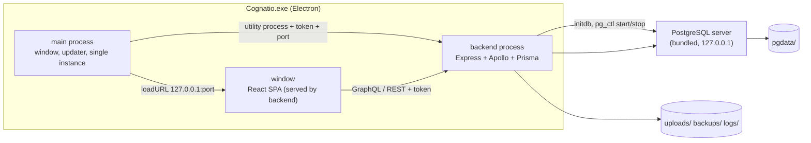
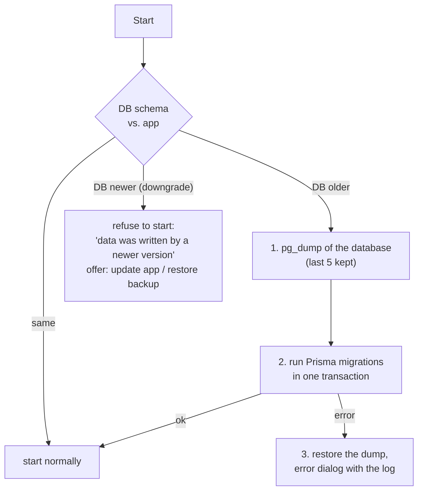
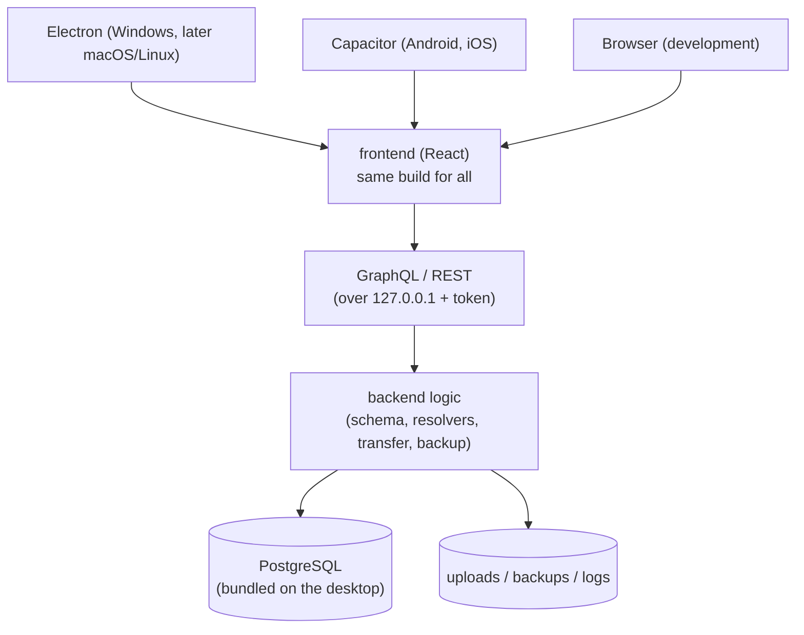
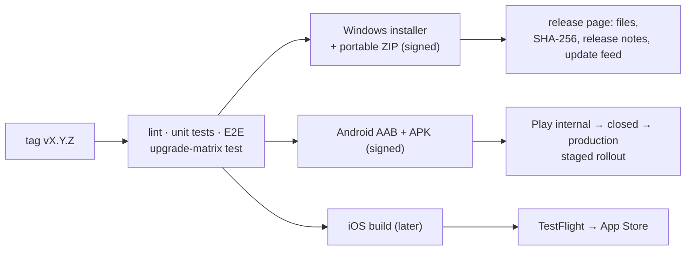

# Distribution concept: desktop app, Android, iOS, releases

Status: **decided and largely implemented.** The Windows app (phases 0–3, 09.10.2026) and the Linux app (10.10.2026) exist; Android/iOS follow later in a fork. Chapters 3 and 6 describe what was built (the status notes in them say what is still open), chapter 4 is background for the fork. The tables in chapter 1 show the state before the work started. Decisions are collected in [chapter 8](#8-decisions-needed).

**Decided on 09.10.2026:**

- **PostgreSQL stays.** The Windows app bundles its own PostgreSQL server; a bigger installer is accepted (chapter 2, section 3.5).
- **The Windows app comes first.** The Linux app (AppImage and `.deb`, same Electron build) was added on 10.10.2026, see section 3.7.
- **Android/iOS later as a fork** of the repository with a complete rebuild; the database for the phone is decided then (PGlite or SQLite). Chapter 4 is kept as background for that.

Goal: Cognatio should run in several ways from **one code base**:

| Branch | Target          | Wanted result                                                                                                                        |
| ------ | --------------- | ------------------------------------------------------------------------------------------------------------------------------------ |
| 1      | Windows desktop | Install once, double-click an `.exe`, backend and frontend start in the background, the UI opens in its own window like a normal app |
| 2      | Android         | Stand-alone app (no server needed), later also iOS                                                                                   |
| 3      | All             | Install, update, upgrade, data migration, release and version number concept                                                         |

The web variant (browser + Node + PostgreSQL) is used for development: `npm run db:start` runs the same PostgreSQL that the app bundles (see the README). A server installation is not offered.

---

## 1. Starting point and what stands in the way

| Fact in the code today                                                                                                                                  | Consequence                                                                                                                                                                     |
| ------------------------------------------------------------------------------------------------------------------------------------------------------- | ------------------------------------------------------------------------------------------------------------------------------------------------------------------------------- |
| Backend is Node 22 + Express + Apollo + Prisma 7 with **PostgreSQL** (`@prisma/adapter-pg`)                                                             | PostgreSQL is a separate server process. It cannot run on Android/iOS and is heavy to bundle on Windows. **The database is the key decision** (chapter 2).                      |
| Schema uses `String[]` (`languages`, `phonetics`)                                                                                                       | Not available on SQLite in Prisma; needs a small schema change if we move to SQLite.                                                                                            |
| Backend does **not** serve the frontend in production; the frontend uses relative URLs (`/graphql`, `/api`, `/uploads`) and the Vite dev proxy          | Needs a production mode: backend serves `frontend/dist` (or a configurable API base URL for the mobile shell).                                                                  |
| Media in `backend/uploads/` (`UPLOAD_DIR`), backups in `../backups` (`BACKUP_DIR`), logs in a log dir; paths relative to `process.cwd()`                | Needs **one data directory** (`COGNATIO_DATA_DIR`) that is outside the program folder (per-user app-data folder).                                                               |
| Migrations: originally Prisma `migrate deploy`; since 09.10.2026 an own runner (`backend/src/lib/migrations.ts`, P3 in 3.6), single init migration      | Good base. Needs safety backup, rollback and downgrade protection (chapter 3.4).                                                                                                |
| **Full backup/restore exists** (`cognatio-backup` ZIP, `manifest.json` with `version`, `data.json`, `files/`, SHA-256) and import with merge strategies | This is the **migration bridge** for everything: web/development → desktop, PostgreSQL → SQLite, desktop → phone, old → new version. The format must stay stable and versioned. |
| Versions: root `1.0.0`, backend `1.0.0`, frontend `0.0.0`, `APP_VERSION` env optional                                                                   | Needs one source of truth (chapter 6).                                                                                                                                          |
| Log viewer/export/clear in Settings                                                                                                                     | Reused for error analysis on the desktop and the phone (users can send the ZIP).                                                                                                |
| Downloads use `<a download>`/`saveBlob`                                                                                                                 | Do not work in a mobile WebView; need a native share/save path.                                                                                                                 |

### Security must-haves for every local variant

The backend will run on the user's machine without a login. That is fine only if:

1. It **listens on `127.0.0.1` only** (never `0.0.0.0`) on a port chosen at random at the first start and kept from then on (`desktop.json`; the page keeps its settings in the local storage of its origin, which includes the port). If that port is taken, the backend takes a free one, and the shell keeps that one.
2. Every request needs a **random per-start token** (header or cookie set by the shell). Otherwise any web page or any other app on the device can call `http://127.0.0.1:port/graphql` (CORS does not protect against simple requests, DNS rebinding, or other apps).
3. `helmet`/CSP stay on; CORS restricted to the app origin.
4. Data directory only readable by the user (default per-user folder).

---

## 2. The key decision: the database

**Decision (09.10.2026): option A for the desktop – PostgreSQL stays and is bundled with the Windows app.** The mobile apps will be a fork with a complete rebuild, so the database question is answered there (options B and D below). The table is kept as the basis for that later decision.

The same question applies to desktop, Android and iOS.

| Option                                                                                                                                      | Desktop | Android/iOS    | Effort                        | Notes                                                                                                                                                                                                                                                                                                                                              |
| ------------------------------------------------------------------------------------------------------------------------------------------- | ------- | -------------- | ----------------------------- | -------------------------------------------------------------------------------------------------------------------------------------------------------------------------------------------------------------------------------------------------------------------------------------------------------------------------------------------------- |
| **A. Keep PostgreSQL** (bundle a portable PG, e.g. `embedded-postgres`)                                                                     | works   | **impossible** | small for desktop             | +100–200 MB installer, one more process to supervise (start, port, crash, upgrade of PG major versions = dump/restore). Blocks the mobile branch.                                                                                                                                                                                                  |
| **B. SQLite everywhere** (Prisma driver adapter `better-sqlite3` or `libsql`)                                                               | works   | works          | medium: 3–5 days incl. tests  | One file = the database. Trivial backup/rollback (copy the file), no process to manage. Needs: `String[]` → JSON text (or child table), no `mode: 'insensitive'` (use normalised columns or `COLLATE NOCASE`), new init migration, adapting queries that use arrays. The PostgreSQL variant would be dropped or kept as a second, separate schema. |
| **D. PGlite** (PostgreSQL compiled to WebAssembly, runs inside Node or a WebView; Prisma via the community adapter `pglite-prisma-adapter`) | works   | works          | small to medium, spike needed | Same SQL dialect and schema (`String[]` stays). No server process. Caveats: adapter not official, Prisma cannot apply migrations to an existing PGlite database (we would run our SQL migration files ourselves), slower than native, young project. Candidate for the mobile fork.                                                                |
| **C. Two engines** (SQLite local, PostgreSQL for servers)                                                                                   | works   | works          | large, permanent              | Prisma fixes the provider per schema → two schemas, two migration histories, double test matrix. Not recommended for a one-person project.                                                                                                                                                                                                         |

The original recommendation was B; after discussing it, PostgreSQL stays (the code, the tooling and the experience with it are worth more than a smaller installer). For the mobile fork, D is tried first and B is the fallback.

Migration path of existing PostgreSQL data: full backup in the old installation → restore in the new one (no special tool, format is DB-independent).

---

## 3. Branch 1: Windows desktop app

### 3.1 Options

|                                               | **Electron** (recommended)                                                               | Tauri 2 + Node sidecar                                                | Node single executable + Edge `--app` window                                            |
| --------------------------------------------- | ---------------------------------------------------------------------------------------- | --------------------------------------------------------------------- | --------------------------------------------------------------------------------------- |
| Idea                                          | Chromium + Node in one app; backend runs in a child/utility process, window shows the UI | Rust shell with system WebView2, backend as bundled sidecar process   | Small launcher (Node SEA) starts backend and opens `msedge --app=http://127.0.0.1:port` |
| Size                                          | 150–200 MB installed                                                                     | 30 MB + Node runtime (~80 MB)                                         | ~90 MB                                                                                  |
| Reuses backend unchanged                      | yes (same Node)                                                                          | yes (sidecar), but Node still shipped                                 | yes                                                                                     |
| Own window, icon, menu, tray, single instance | yes                                                                                      | yes                                                                   | only partly (Edge window, no real app identity)                                         |
| Auto-update                                   | mature (`electron-updater`, differential)                                                | built-in updater plugin                                               | must be built by hand                                                                   |
| Native modules (SQLite)                       | rebuilt for Electron ABI (`electron-rebuild`, prebuilt binaries exist)                   | as sidecar: normal Node                                               | normal Node                                                                             |
| Same engine on all machines                   | yes (bundled Chromium, no surprises)                                                     | depends on WebView2 version                                           | depends on installed Edge                                                               |
| Mobile relevance                              | none                                                                                     | Tauri also targets Android/iOS, but the Node backend cannot run there | none                                                                                    |
| Risk                                          | size                                                                                     | two toolchains (Rust + Node)                                          | "not a real app", updater DIY                                                           |

**Recommendation: Electron.** Same language and runtime as the backend, best update and installer tooling, one engine for all machines. The size is acceptable for a family-tree application. The third option is a cheap fallback for a first prototype.

### 3.2 Runtime design

Start sequence: single-instance lock → choose data dir → start the backend (an Electron utility process) on the kept port (or a free one) with a random token → the backend starts **PostgreSQL (3.5)** and runs the **migration check (3.4)** → it reports its port (IPC message) → open the window. Closing the window ends the backend and stops PostgreSQL (no tray). Crash of the backend → the shell stops a database server left running and shows a dialog with "Restart", "Open log folder" and "Quit".

Required code changes (small, useful for all variants):

- Production mode: backend serves `frontend/dist` with SPA fallback (implemented: `FRONTEND_DIR`).
- `COGNATIO_DATA_DIR` replaces the `cwd`-relative paths (uploads, backups, logs, db).
- `HOST=127.0.0.1`, `PORT` (the kept port; `0`: a free one) with `COGNATIO_PORT_FALLBACK=1` (a free port if it is taken), token middleware.
- Frontend: configurable API base (needed for mobile anyway).

### 3.3 Installation

**Status (phase 2 implemented):** `desktop/` contains the Electron shell (`src/`), `electron-builder.yml` and `scripts/` (stage, afterPack, smoke test). Installer built and tested: silent install to a folder, start, uninstall (data kept). Installer about 150 MB (Electron + backend + PostgreSQL). Since then done: the app icon, the uninstall question "also delete my data", the portable ZIP (`desktop/scripts/portable.mjs`), reproducible backend dependencies (generated lock file for the stage) and the app ID `app.cognatio.desktop` (decided). Crash handling stops the database itself and a safety backup is restored automatically after a failed migration. The program file is hardened with Electron fuses (no RunAsNode, `NODE_OPTIONS` or `--inspect`, only its own `app.asar`; the backend runs as a utility process). Open: code signing with SignPath (after the public repository; together with it the fuse for the asar integrity check), `winget`, MSIX.

| Topic                        | Proposal                                                                                                                                                                                                                                                                                                                                                                                                           |
| ---------------------------- | ------------------------------------------------------------------------------------------------------------------------------------------------------------------------------------------------------------------------------------------------------------------------------------------------------------------------------------------------------------------------------------------------------------------ |
| Installer                    | NSIS via `electron-builder`, **per-user install, no admin rights**, into `%LOCALAPPDATA%\Programs\Cognatio`; Start-menu entry, optional desktop icon                                                                                                                                                                                                                                                               |
| Data                         | `%APPDATA%\Cognatio\` → `pgdata\` (database cluster), `uploads\`, `backups\`, `logs\`, `config.json`. **Program and data are separate**, so update/uninstall never touches the data                                                                                                                                                                                                                                |
| Uninstall                    | keeps data by default; checkbox "also delete my data" (with a warning and pointer to Settings → Backup)                                                                                                                                                                                                                                                                                                            |
| Portable variant             | ZIP that stores data next to the exe (`portable` marker file) — useful for a USB stick; not auto-updated                                                                                                                                                                                                                                                                                                           |
| Code signing                 | Needed against the SmartScreen warning. Chosen: SignPath Foundation (free for open source; needs the public repository and the GPL licence, manual release of every signing). Azure Trusted Signing is only open to individuals in the USA and Canada, and a normal certificate has its key on hardware or in the cloud only. Until then the app works unsigned; the release notes explain the SmartScreen warning |
| Distribution channels        | 1. GitHub release page of the public repository (download and update feed), 2. `winget` manifest (later), 3. Microsoft Store/MSIX (later, optional)                                                                                                                                                                                                                                                                |
| Data folder in cloud folders | Blocked: a PostgreSQL data directory in OneDrive/Dropbox gets corrupted. Settings may offer a custom folder with a warning                                                                                                                                                                                                                                                                                         |

### 3.4 Update, upgrade and data migration

**Status (phase 3 implemented):** `desktop/src/updater.ts` (electron-updater, daily check, background download, switch in Settings → System, `COGNATIO_UPDATE_URL`), release tooling (`npm run release`), tag pipeline and upgrade matrix (`test:upgrade`) exist; the process is in [release-checklist.md](release-checklist.md). Decisions taken: the releases of the public GitHub repository are the feed (`releases/latest/download`, the newest release that is no pre-release; the private GitLab repository builds the same way with the permalink of its latest release); a beta channel (Settings → System, `release:beta`, see [release-checklist.md](release-checklist.md)) reads `beta.yml` from the pre-release `beta-channel` (GitLab: the package `cognatio-channel/beta`), which every release refreshes, `commit-and-tag-version` for version and tag (the changelog is rolled by `scripts/release-changelog.mjs`, Keep-a-Changelog format stays), app ID `app.cognatio.desktop`. **Not done:** signing needs a certificate (pipeline is prepared, then set `CSC_LINK` and `CSC_KEY_PASSWORD`; until then installers are unsigned), the release jobs (`.github/workflows/release.yml`, the release stage of `.gitlab-ci.yml`) run for the first time with the first tag (the workflow Desktop build and the manual jobs `build:windows` and `build:linux` build without publishing), and the repository must be public so installed apps can read the feed.

**Program update** (`electron-updater`):

- Checks a release feed at start and once a day; downloads in the background (always the whole installer); shows "Update 1.3.0 ready — restart now / later"; installs on quit.
- Feed: GitHub Releases of the public repository (`releases/latest/download/`, generic provider; GitLab: permalink `releases/permalink/latest/downloads/`), derived from the project address in `desktop/src/feeds.ts`. Channels: `stable` (default), `beta` (opt-in in Settings).
- The updater checks the SHA-512 of the download against the feed file. The publisher signature is checked only once the installer is signed – until then the file and its hash come from the same server.
- **Privacy:** the update check is the only outgoing connection of the app. It is documented, can be switched off in Settings ("Check for updates: on/off"), and sends no data except the current version.
- Manual path always possible: download the new installer, run it over the old installation (same installer = upgrade).

**Data migration on version change** — runs on every start, before the window opens:

Rules ("migration policy"):

1. **Forward-only migrations**, never edited after release.
2. **Expand → contract**: a release adds columns/tables; removing or renaming happens at the earliest one release later. Destructive steps only after the safety backup.
3. The table `_prisma_migrations` records every applied migration with its checksum (no separate `meta` table): a database with migrations this version does not know counts as written by a newer version.
4. **Upgrade matrix test in CI:** small fixture databases from _every released version_ are migrated to the current one and checked (row counts, sample data, backup export/import round-trip).
5. Backup format `version` (integer) is raised only on incompatible changes; a newer app reads all older formats, an older app rejects newer formats with a clear message.
6. Migration chain is kept for a whole major version; squashing only in a new major, which requires a **bridge release** (users of the old major first update to its last minor).
7. Rollback restores the `pg_dump` taken in step 1 over the half-migrated database (`pg_restore --clean`); the user never has to do anything with PostgreSQL directly.

**Upgrade from a web/development installation:** Settings → Backup → download in the old installation; in the desktop app Settings → Restore (or a first-run screen "Import data from an earlier installation"). No special tooling.

### 3.5 Bundled PostgreSQL

**Status (phase 1 implemented):** the backend itself manages the server (`backend/src/lib/postgres/`), not the Electron main process: `COGNATIO_PG_DIR` switches it on. Electron therefore only forks the backend and sends `{type:'shutdown'}` to stop it (Windows has no signals). Safety backups go to `backups/db/`. The safety backup is restored automatically after a failed migration (each migration is also one transaction). Not yet done: the antivirus/OneDrive hints in the UI, the PostgreSQL major-upgrade path. Tested with real binaries, including a data path with umlaut and space.

| Topic                                                                 | Design                                                                                                                                                                                                                                                                                                                                                             |
| --------------------------------------------------------------------- | ------------------------------------------------------------------------------------------------------------------------------------------------------------------------------------------------------------------------------------------------------------------------------------------------------------------------------------------------------------------ |
| Binaries                                                              | PostgreSQL 16.15 for Windows x64: the binary ZIP of EDB (checksum pinned in `scripts/fetch-postgres.mjs`), only `bin/`, `lib/`, `share/`, slimmed further by `desktop/scripts/prune-postgres.mjs` (only the programs the app uses). Linux: see 3.7. Licence: PostgreSQL licence (permissive). Shipped inside the program folder, so updates replace it.            |
| Major version                                                         | One PostgreSQL major version per app major version (start: 16, like the development database). Minor updates of PostgreSQL (16.x) just replace the binaries.                                                                                                                                                                                                       |
| First start                                                           | `initdb` into `%APPDATA%\Cognatio\pgdata` with `--encoding=UTF8 --locale=C` (independent of the Windows language), authentication `scram-sha-256`, a random password stored in `config.json` (only readable by the user). Then create the database `cognatio` and run the migrations.                                                                              |
| Start/stop                                                            | The backend starts the server with `pg_ctl start` on a random free port, `listen_addresses = '127.0.0.1'` (no firewall prompt), waits until it accepts connections and sets `DATABASE_URL` for itself. On quit: `pg_ctl stop -m fast`; the Electron main process stops a server that a crashed or killed backend left behind. No Windows service, no admin rights. |
| After a crash                                                         | A stale `postmaster.pid` is detected and removed if its process no longer exists; PostgreSQL then recovers from its WAL itself.                                                                                                                                                                                                                                    |
| Safety backup                                                         | Before every migration and once a day: `pg_dump -Fc` into `backups\db\` (last 5 kept), in addition to the existing user-facing backup ZIP.                                                                                                                                                                                                                         |
| PostgreSQL major upgrade (e.g. 16 → 17), only in an app major version | The upgrade release ships the old and the new binaries: dump with the old version, `initdb` with the new one, restore, keep the old `pgdata` as `pgdata.old` until the user removes it (or for 30 days). Alternative: `pg_upgrade`. Tested in the upgrade matrix.                                                                                                  |
| Known Windows pitfalls                                                | User names with umlauts or spaces in `%APPDATA%` (test `initdb` with such paths), antivirus software locking files in `pgdata`, the server must not run as administrator (fine with a per-user install), a second app instance (single-instance lock).                                                                                                             |

### 3.6 Preparing the mobile fork during the Windows work

Goal: build the Windows app so that the later switch of the database (PGlite or SQLite) and of the platform stays small, **without** noticeable extra effort now. Assessed against the code as of 09.10.2026.

**How much is tied to PostgreSQL today:** little, and in few places. `mode: 'insensitive'` and `has`/`hasSome` on `phonetics` in `backend/src/lib/search/search.ts`, the list fields `languages` and `phonetics` plus a GIN index in the schema, and `SELECT 1` as health check (portable). 12 backend files use Prisma directly, 8 use the file system, 5 frontend files trigger downloads themselves (`saveBlob`/`createObjectURL`).

| #   | Measure                                                                                                                                                                                                                                          | Effort now               | Benefit for Windows                                                                                           | Benefit for the fork                                                           | Verdict                                                                                         |
| --- | ------------------------------------------------------------------------------------------------------------------------------------------------------------------------------------------------------------------------------------------------ | ------------------------ | ------------------------------------------------------------------------------------------------------------- | ------------------------------------------------------------------------------ | ----------------------------------------------------------------------------------------------- |
| P1  | Data directory, API base URL, 127.0.0.1 + token, single version source (phase 0)                                                                                                                                                                 | needed anyway            | required                                                                                                      | required                                                                       | **do** – just build them platform-neutral                                                       |
| P2  | One `platform` module in the frontend (`saveFile`, `openFile`, `openExternal`) with a browser and an Electron implementation; the 5 download places use it                                                                                       | ~½ day on top of phase 0 | native "save as" dialog in the app                                                                            | Capacitor only adds a third implementation                                     | **do**                                                                                          |
| P3  | **Own migration runner:** applies `prisma/migrations/*/migration.sql` in order and records them in `_prisma_migrations`, instead of calling the Prisma CLI                                                                                       | ~1 day                   | the installed app does not need to ship the Prisma CLI; safety backup → migrate → rollback in one place (3.4) | Prisma cannot migrate an existing PGlite database – this runner can            | **do** (part of phase 2)                                                                        |
| P4  | Rule in `code-guidelines.md`: no new PostgreSQL-only features (`tsvector`, `jsonb` operators, extensions such as `pg_trgm`, raw SQL) outside one marked module; an ESLint rule reports `$queryRaw`/`$executeRaw`/`mode: 'insensitive'` elsewhere | 1–2 hours                | –                                                                                                             | keeps the fork's database work as small as it is today                         | **do**                                                                                          |
| P5  | Backup round-trip test: every field of every table survives export → import (the backup ZIP is the bridge from desktop to phone)                                                                                                                 | ~½ day                   | protects the safety backup and restore of the Windows app                                                     | the move of the data to the phone is safe                                      | **do**                                                                                          |
| P6  | Small integration test suite against a real database (search, family-tree scoping, import, backup), in addition to today's Prisma mocks                                                                                                          | 1–2 days                 | proves the bundled PostgreSQL works on Windows                                                                | the database spike for the fork becomes "run this suite against PGlite/SQLite" | **dropped** (11.10.2026) – the E2E tests and `test:upgrade` already run against a real database |
| P7  | Rule: new file access in the backend only through `lib/files/` (uploads, backups, logs), no new direct `fs` calls elsewhere                                                                                                                      | minutes (rule only)      | –                                                                                                             | fewer places to adapt if the phone has no Node file system                     | **do** (rule only, no refactoring now)                                                          |
| P8  | Data access layer (repositories) between resolvers and Prisma                                                                                                                                                                                    | 1–2 weeks                | none                                                                                                          | only needed if the phone runs without Prisma (option M2)                       | **not now**                                                                                     |
| P9  | Move `languages`/`phonetics` into separate tables                                                                                                                                                                                                | ~1 day + migration       | none                                                                                                          | equally expensive later                                                        | **not now**                                                                                     |
| P10 | Moving all `fs` code into a storage abstraction                                                                                                                                                                                                  | 2–3 days                 | none                                                                                                          | only needed for M2                                                             | **not now**                                                                                     |

Extra effort of the "do" items beyond the Windows work itself: about **2–3 days**, and most of it (P2, P3, P5) also improves the Windows app.

**Status 09.10.2026:** P1, P2, P3, P4, P5 and P7 are implemented (environment variables in the README, rules in `code-guidelines.md`, ESLint rule in `backend/eslint.config.mjs`). P6 was dropped.

**Multiple devices:** no sync in scope. The existing merge import already works as a manual "sync" (export ZIP on device A, import with merge on device B). A real sync is a separate feature (chapter 9).

### 3.7 Linux app

**Status (10.10.2026): implemented** (x64 only), details in the [README](../README.md#linux-app).

| Topic         | Decision                                                                                                                                                                                                                                                                                                           |
| ------------- | ------------------------------------------------------------------------------------------------------------------------------------------------------------------------------------------------------------------------------------------------------------------------------------------------------------------ |
| Formats       | AppImage (one file, updates itself from `latest-linux.yml`, beta channel `beta-linux.yml`; puts itself into the application menu) and `.deb` (apt installs the libraries, menu entry and sandbox set-up; no self-update, installed again for a new version). Other formats (Flatpak, rpm, arm64) are not planned.  |
| PostgreSQL    | Built from the official source archive 16.15 (checksum pinned) without ICU, OpenSSL, readline and zlib, with relative run paths so it runs from any folder. Why not binaries: the Zonky packages lack `pg_dump`/`pg_restore`, EDB offers no Linux binaries. The build takes a few minutes and is cached in the CI. |
| Compatibility | The CI builds on Debian 12, so glibc 2.36 or newer is required (Debian 12, Ubuntu 24.04, Fedora 38 and newer). AppImage needs FUSE 2; Ubuntu 24.04 restricts user namespaces, so the AppImage may need `--no-sandbox` there, the `.deb` sets the sandbox up itself.                                                |
| Data          | `~/.config/Cognatio/`, same layout as on Windows; no portable variant.                                                                                                                                                                                                                                             |
| Pipeline      | `build:linux` (manual trial) and `release:linux` (tag) on the shared Linux runners; `release:publish` waits for it. `release:linux` runs for the first time with the first tag.                                                                                                                                    |
| Tested        | Build, smoke test, `.deb` installation and AppImage menu entry in WSL (Ubuntu 24.04); still open: a real Ubuntu/Fedora desktop (checklist section 4).                                                                                                                                                              |

---

## 4. Branch 2: Android (and later iOS)

> **Decision (09.10.2026):** the mobile apps are built later in a **fork** with a complete rebuild. This chapter is the background for that work; the database there is decided between PGlite and SQLite (chapter 2).

### 4.1 What is needed, independent of the approach

1. **Data layer works without a server process** (SQLite, chapter 2).
2. **Responsive and touch-tested UI.** Check sidebar/header on phone width, tree view with pinch-zoom and drag, forms, dialogs, date inputs, safe areas (notch), on-screen keyboard. Many parts already work at 375 px (E2E mobile viewport exists in the browser tests); the tree needs real device tests.
3. **Files:** upload via the system photo/file picker; download/export/share via the native share sheet or "save as" instead of `<a download>`; large ZIPs (export, import, backup and restore up to 2 GB by default) must be streamed, not held in memory.
4. **Lifecycle:** Android may kill the app in the background; the backend/data layer must restart cleanly and the UI must reconnect. SQLite in WAL mode with proper close.
5. **Security:** same token rule for a localhost backend (other apps on the device could otherwise call it). Optional app lock (biometric/PIN).
6. **Packaging and signing:** Android App Bundle (AAB), signing key in the CI secrets, `applicationId` such as `app.cognatio` (choose once, cannot change).
7. **Privacy statement** for the store (no data leaves the device; update check by the store).

### 4.2 Architecture options

|                  | **M0: Companion shell**                                                                                     | **M1: Capacitor + embedded Node**                                                                                                                                        | **M2: Capacitor + data layer in the WebView**                                                                                                         |
| ---------------- | ----------------------------------------------------------------------------------------------------------- | ------------------------------------------------------------------------------------------------------------------------------------------------------------------------ | ----------------------------------------------------------------------------------------------------------------------------------------------------- |
| Idea             | Capacitor app (or PWA) that shows the UI and talks to a server: the desktop app on the LAN or a home server | Capacitor WebView + `nodejs-mobile` runs the **existing backend** on the phone, WebView talks to `127.0.0.1`                                                             | The UI runs the GraphQL schema and resolvers **inside the WebView** with SQLite (`@capacitor-community/sqlite` or SQLite-WASM); no Node on the device |
| Stand-alone      | **no**                                                                                                      | yes                                                                                                                                                                      | yes                                                                                                                                                   |
| Reuse of backend | 100 %                                                                                                       | ~95 % (Node 18-based runtime, native SQLite module for arm64)                                                                                                            | ~60 %: business logic reusable, but Prisma, Express, `fs`, multer, ZIP streaming must be replaced by a portable "core" package                        |
| Effort           | 1–2 weeks                                                                                                   | 3–5 weeks incl. a spike                                                                                                                                                  | 8–12 weeks (needs a repository abstraction, other DB access than Prisma)                                                                              |
| App size         | ~10 MB                                                                                                      | +40–60 MB (Node)                                                                                                                                                         | ~10–20 MB                                                                                                                                             |
| Risks            | needs a running server; not "stand-alone"                                                                   | `nodejs-mobile` is community-maintained, slower start, native modules must be cross-compiled per ABI; Android/iOS store policies are met, but updates of Node lag behind | biggest refactor; performance of big imports in a WebView; long-term cleanest                                                                         |
| iOS              | same shell                                                                                                  | possible (`nodejs-mobile` supports iOS, JIT-less, slower; native module built as framework)                                                                              | **simplest** — identical code on Android and iOS                                                                                                      |

**Recommendation (staged, with a decision gate):**

1. **M1 spike first** (3–5 days): Capacitor + `nodejs-mobile` + SQLite adapter, open the app, create a person, export a backup. If start time (< 3 s), stability and build effort are acceptable → continue with M1 for Android.
2. If the spike shows fragile native builds, go to **M2** (bigger, but one code path for Android and iOS and no Node on the phone).
3. **M0** is optional as a cheap intermediate step if a phone client for the desktop/home server is wanted early. It does not fulfil "stand-alone".

The decision between M1 and M2 does **not** block the preparation work: production mode, data directory, configurable API base, token, SQLite and the "download/share" abstraction are needed by both.

### 4.3 Install, update, upgrade, migration on Android

| Topic                  | Proposal                                                                                                                                                                                                                                                       |
| ---------------------- | -------------------------------------------------------------------------------------------------------------------------------------------------------------------------------------------------------------------------------------------------------------- |
| Install                | Play Store (main), signed APK download on the release page (sideload), optionally F-Droid later                                                                                                                                                                |
| Data                   | app-private storage (`filesDir`): `cognatio.db`, `uploads/`, `backups/`, `logs/`; not visible to other apps, removed on uninstall (warn in Settings, offer a backup export before)                                                                             |
| Update                 | Play Store handles it (staged rollout 10 % → 50 % → 100 %); the APK download has no auto-update (mention "Obtainium"/manual)                                                                                                                                   |
| Migration              | **identical to the desktop**: at app start compare schema versions, safety copy, migrate, rollback on error, downgrade guard (a Play update never downgrades; a manually installed older APK is refused by Android unless data is cleared)                     |
| Backup                 | Settings → Backup → share sheet (Drive, e-mail, USB); Settings → Restore → system file picker. Android _Auto Backup_ to Google Drive is **switched off** for the database by default (family data should not leave the device unnoticed); may become an opt-in |
| Move data from desktop | export backup on the desktop, open it on the phone (share/file picker)                                                                                                                                                                                         |
| Store requirements     | Play Console account (25 USD once), target the current API level, privacy policy URL, data-safety form ("no data collected")                                                                                                                                   |

### 4.4 iOS (later)

- Same Capacitor project (`npx cap add ios`); needs a **Mac with Xcode** (or a cloud Mac CI) and the **Apple Developer Program (99 USD/year)**.
- Distribution: TestFlight (beta) → App Store; review takes 1–3 days, an offline app with no account is uncomplicated, but Apple rejects apps that "look like a web page" — the native share/files integration and offline function help.
- Updates only via the App Store; data migration and backup exactly as on Android (share sheet, Files app). iCloud backup of the app container is on by default → decide (ideal: leave on, the data is then in the user's own iCloud).
- With M2, iOS is almost free once Android works; with M1 it needs an extra native-module build for iOS.

---

## 5. Common architecture after the changes

Platform differences are limited to a thin **shell layer** (window, file picker, share/save, updater, lifecycle). The frontend gets a small `platform` interface (`saveFile`, `pickFile`, `openExternal`, `appVersion`) with a browser default, so the shells only supply implementations.

---

## 6. Release concept and version numbers

### 6.1 Version numbers

**Semantic Versioning `MAJOR.MINOR.PATCH`** for the whole product (backend, frontend, shells share **one version**, lock-step).

| Part        | Raised when                                                                                                                                                                        |
| ----------- | ---------------------------------------------------------------------------------------------------------------------------------------------------------------------------------- |
| MAJOR       | incompatible change for users: data/backup format that older versions cannot read, removed feature, migration chain squashed (needs a bridge release), platform requirement raised |
| MINOR       | new features, backward-compatible migrations                                                                                                                                       |
| PATCH       | bug fixes, translations, security fixes without new features                                                                                                                       |
| Pre-release | `1.4.0-beta.1`, `1.4.0-rc.1` (beta channel only)                                                                                                                                   |

Source of truth: the **root `package.json`** (already read by the frontend build). A script sets the same number in `backend/package.json`, `frontend/package.json`, the Electron and Capacitor config; CI fails if they differ.

Separate compatibility numbers (they are not shown in the app so far; the migration table and the backup manifest hold them):

- `schemaVersion` — number of the last DB migration.
- `backupFormat` — `version` in `manifest.json`.

Platform mappings:

| Platform | Field                                            | Value                                                                                                                  |
| -------- | ------------------------------------------------ | ---------------------------------------------------------------------------------------------------------------------- |
| Windows  | file/product version                             | `MAJOR.MINOR.PATCH.BUILD`                                                                                              |
| Android  | `versionName` / `versionCode`                    | `1.4.2` / `MAJOR*1 000 000 + MINOR*10 000 + PATCH*100 + BETA_OR_BUILD` (must only ever grow; e.g. 1.4.2 → `1 040 200`) |
| iOS      | `CFBundleShortVersionString` / `CFBundleVersion` | `1.4.2` / CI build counter (must grow per upload)                                                                      |

### 6.2 Process

- Commits follow **Conventional Commits** (already used: `feat:`, `fix:`, `refactor:`). The type decides the version bump (`fix` → PATCH, `feat` → MINOR, `!`/`BREAKING CHANGE` → MAJOR).
- Tooling: `commit-and-tag-version` creates the version bump, `CHANGELOG.md` entry and the tag `vX.Y.Z`. `CHANGELOG.md` keeps the Keep-a-Changelog format.
- **Trunk-based:** development on `main`; hotfix branches `release/1.4` only when an older line needs a fix. Only the latest minor is supported (one-person project).
- **Tag `vX.Y.Z` triggers the release pipeline:**

- **Channels:** `nightly` (main, optional), `beta` (pre-releases, opt-in), `stable`. Play Store maps to internal / closed / production tracks.
- **Release notes:** generated from the changelog; the app shows them in the help chapter "Version history".
- **Artifacts:** `Cognatio-Setup-1.4.2.exe`, `Cognatio-1.4.2-portable.zip`, `Cognatio-1.4.2.AppImage`, `Cognatio-1.4.2.deb`, `SHA256SUMS`, `SHA256SUMS-linux` (planned for the phone: `cognatio-1.4.2.aab/.apk`, optional SBOM).
- **Release checklist** ([release-checklist.md](release-checklist.md)): tests green, upgrade matrix green, migration tried on a copy of real data, changelog checked, version consistent, signed, installer smoke test on a clean Windows VM and a real phone, update from the previous version tested.
- **Supported upgrade path:** any version → latest within the same major. Across a major: only from the last minor of the previous major.

### 6.3 Costs and accounts (overview)

| Item                                       | Cost                               | Needed for             |
| ------------------------------------------ | ---------------------------------- | ---------------------- |
| Windows code signing (SignPath Foundation) | free for open source               | no SmartScreen warning |
| Google Play developer account              | 25 USD once                        | Play Store             |
| Apple Developer Program + a Mac            | 99 USD/year + hardware/cloud Mac   | iOS                    |
| Domain / hosting for update feed           | optional (GitHub Releases is free) | updates                |

---

## 7. Roadmap with rough effort

| Phase                            | Content                                                                                                                                                                            | Effort                           |
| -------------------------------- | ---------------------------------------------------------------------------------------------------------------------------------------------------------------------------------- | -------------------------------- |
| **0. Preparation**               | single version source, production mode (backend serves frontend), `COGNATIO_DATA_DIR`, localhost binding + token, configurable API base, `platform` interface (save/pick file)     | 1–1.5 weeks                      |
| **1. Bundled PostgreSQL**        | binaries in the build, `initdb` on first start, start/stop with random port and password, crash recovery, `pg_dump` safety backups, tests with paths containing umlauts and spaces | 1 week                           |
| **2. Windows app**               | Electron shell, installer, data dir, own migration runner (P3) with safety backup/rollback, single instance, crash dialog, logs; fork preparations P2, P4, P5, P7 (3.6)            | 2–2.5 weeks                      |
| **3. Update + release pipeline** | updater, signing, tag pipeline, release notes, upgrade-matrix test, release checklist                                                                                              | 1–1.5 weeks                      |
| **4. Android (fork, later)**     | M1 spike (go/no-go vs. M2), Capacitor project, touch/tree tests on a real phone, share/pick files, signing, Play internal track                                                    | 3–5 weeks                        |
| **5. Android release**           | store listing, privacy policy, staged rollout                                                                                                                                      | 1 week                           |
| **6. iOS**                       | Mac/CI, TestFlight, review                                                                                                                                                         | 1–2 weeks (M2) or 2–3 weeks (M1) |

Phases 0–3 give a complete, updatable Windows app (decided: this comes first) and are done; the Linux app was added on top (3.7). Android follows later in a fork.

---

## 8. Decisions needed

Please decide (my recommendation first):

1. ~~**Database**~~ → **decided 09.10.2026: PostgreSQL stays, bundled with the Windows app; the mobile fork decides on its own.**
2. **Desktop shell:** Electron, Tauri + sidecar, or the light Edge-window variant? → **Electron.**
3. **Windows only or also macOS/Linux** with the same Electron build (cost: signing/notarisation on macOS, ~100 USD/year)? → Windows first; Linux (AppImage, `.deb`) added 10.10.2026; macOS not planned.
4. ~~**Mobile architecture**~~ → **postponed: a fork with a complete rebuild, after the Windows app.**
5. **Sync between devices:** only manual (backup/merge import), or planned later as its own feature? → manual for now.
6. **Update policy:** automatic download with a restart prompt, opt-out and beta channel? Is the update check acceptable as the only network access? → yes, with a switch in Settings.
7. **Distribution:** update feed and main repository? → **decided 09.10.2026: GitLab Releases of a new public project (one neutral snapshot commit, the history stays private); the GitHub workflow was removed.** → **changed 11.10.2026: the public repository is on GitHub (one snapshot commit per release, `scripts/public-snapshot.mjs`) and its GitHub releases are the feed; development stays in the private GitLab repository, whose pipeline keeps working. `.github/workflows` runs the same checks as `.gitlab-ci.yml`, plus CodeQL.**
8. **Code signing:** invest in a certificate now or later (unsigned builds show a warning)? → **SignPath Foundation, applied for after the public repository exists; the first release may go out unsigned (the release notes say so).**
9. **App identity:** `applicationId` / bundle id and the domain behind it; fixed for the lifetime of the app. → **decided: `app.cognatio.desktop`; no domain.**
10. **Android Auto Backup / iCloud:** off for the database by default? → off on Android, own export.
11. **Versioning:** lock-step single version and the version-code formula above OK? Tooling `commit-and-tag-version` or `release-please`? → **lock-step version; `commit-and-tag-version` (`.versionrc.json`, `scripts/release-*.mjs`).**
12. **Support policy:** only the latest minor gets fixes; bridge release for major upgrades. → **decided 11.10.2026 as proposed.**

## 9. Out of scope / later

- Real multi-device sync (conflict resolution, encryption), cloud accounts.
- Database encryption at rest and an app password; sensible for phones — separate feature.
- macOS packages, further Linux formats (Flatpak, rpm, arm64), Microsoft Store/MSIX, F-Droid.
- Tablet-specific layouts, widgets, share extensions.

## 10. Risks

| Risk                                                                          | Mitigation                                                                                                       |
| ----------------------------------------------------------------------------- | ---------------------------------------------------------------------------------------------------------------- |
| Bundled PostgreSQL fails on some machines (umlauts in paths, antivirus, port) | `--locale=C`, random port, tests on a clean Windows VM with such a user name, clear error dialog with log export |
| `nodejs-mobile` unstable or hard to build                                     | spike with a go/no-go, fallback M2                                                                               |
| Data loss during migration                                                    | safety copy + backup ZIP before every migration, rollback, upgrade-matrix test, downgrade guard                  |
| Localhost backend reachable by other programs                                 | 127.0.0.1 only, per-start token, random port                                                                     |
| SmartScreen/Play/App Store rejections                                         | signing, privacy policy, early internal test tracks                                                              |
| Large imports/backups on phones (memory)                                      | streaming ZIP handling, size warnings                                                                            |
| Solo maintenance of several platforms                                         | one code base, one version, one pipeline; iOS only after Android is stable                                       |
